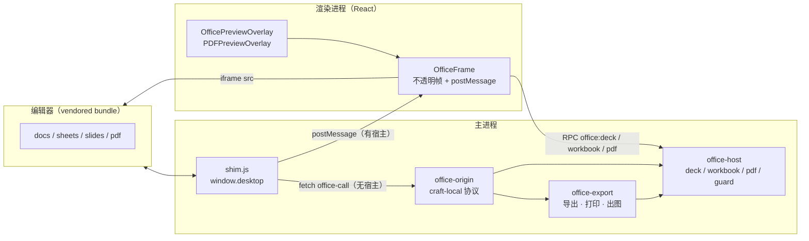

# GenOffice 接入文档

> 对象：`apps/electron` + `packages/office-host` 里的 GenOffice 编辑器接入（docx / xlsx / pptx / pdf）
> 状态：2026-10-31。仓库里已有一份 `./office-embed.md`（构建步骤、验收清单写得细，**但早于导出/海报/直改这三块**）；
> 这份文档是**当前实现的全貌**，两者冲突时以此为准。构建步骤仍以那份为准。
>
> **另一份文档管"我们和他们官方客户端差在哪"**：`genoffice-vs-official-client.md`。四档分类（等价换了地方 /
> 绕路 / 没有这个能力 / 他们自己也没有），每档逐项列清楚，以及"想补的时候要建什么新部件"。

---

## 0. 一句话

**编辑器是别人写的前端，文档的真相在我们这边。** 四个编辑器各自要一个 `window.desktop`（= 它自己的 preload），我们给它的不是 Electron IPC，而是一个**字符串脚本（shim）**，它把编辑器的调用翻译成两种东西：

- **有宿主页**（帧内）：`postMessage` 给宿主页，宿主页再走我们的 RPC；
- **没有宿主页**（导出窗口）：`fetch` 我们的 origin 路由，主进程用**同一套宿主**回答。

宿主（`packages/office-host`）才是文档所在：`.pptx` 在内存模型里、`.xlsx` 在原生 sidecar 里、`.docx`/`.pdf` 只是字节。编辑一律变成 **op**，落盘一律过 **guard**。

---

## 1. 一图



两条路，一套宿主 —— 这是整个接入的地基。

---

## 2. 四类文档，四个编辑器，四个宿主

| 格式 | 编辑器 bundle | **文档在哪** | 宿主 |
| --- | --- | --- | --- |
| `.docx` | `resources/office/docs`（8.3 MB） | 渲染进程内存里的一块字节 | 无（只有 `readBytes`/`writeBytes`） |
| `.xlsx` | `resources/office/sheets`（20.3 MB） | **原生 sidecar** 进程（`xlsx-sidecar.exe`） | `workbook.ts` |
| `.pptx` | `resources/office/slides`（5.3 MB） | **主进程内存模型**（引擎 + session + 撤销栈） | `deck.ts` |
| `.pdf` | `resources/office/pdf`（3.2 MB + 自带 pdf.js + worker） | 渲染进程字节；引擎只在保存/操作时介入 | `pdf.ts` + pdfium |

> 体积是入口 JS 的实测值。`.xlsx` 那个 20 MB 决定了「绝不在对话里内联预览」（见 §7）。

---

## 3. 运行路径

### 3.1 帧内（预览 / 编辑）

`OfficeFrame` 是一个**不透明的 iframe**（`sandbox`、`contextIsolation`），加载 `craft-local://office-<hash>/<app>/`。宿主页与帧之间的协议只有一个：

```js
{ protocol: 'craft-office/1', type: 'ready' | 'open' | 'call' | 'result' | 'event' | 'edit' | 'editResult' | 'selection' }
```

- `open`：宿主把文档字节交给帧，帧自己造 `blob:` URL（**不能**由宿主造，跨源读不到）。
- `call`：编辑器问一句，宿主答一句；`undefined` 表示"这个功能这台机器没有"。
- `event`：宿主主动推（保存对话框路径、关闭保存请求等）。
- `selection`：帧回报选区（连 ProseMirror 的 from/to 一起），宿主据此决定"在对话里继续"有没有东西可继续。

### 3.2 无宿主窗口（导出 / 打印 / 出图）

打印要求**编辑器是顶层文档**（它自己的 `@media print` 才会把功能区和 AI 栏收起来；塞进 iframe 会并成一页、还带上外层的页脚）。所以有一条没有宿主页的路径：

```
craft-local://office-<hash>/docs/?__craftExport=<token>&__craftHeadless=pdf&__craftOut=<token>
```

没有宿主页 ⇒ `window.parent === window` ⇒ 旧实现里 shim 把每个调用 `postMessage` 给自己，**没人回答，每个调用空等 30 秒**（实测：docs 编辑器 60 秒才挂载，导出 20 秒就超时）。

现在的规则：

| 调用类型 | 谁来答 |
| --- | --- |
| 设置类（`getLanguage` / `getTheme` / `getDocumentTheme` / `getAutoSaveDefault` / `getAuthorName` / `getAiPanelPrefs`） | shim 自己，本地默认值 |
| 文档类（`reopenWorkbook` / `consumePendingOpen` / `readFile` / …） | `POST /__craft/office-call/<token>` → 主进程的**同一套宿主** |
| 没有 token、或宿主没注册 | **立即 `undefined`**（不再等 30 秒） |

二进制（`readFile`）以 `{ $bytes: base64 }` 过 JSON，shim 侧解码回 `Uint8Array`。

shim 的三种身份，一个文件：

| 模式 | 触发 | 它额外知道什么 |
| --- | --- | --- |
| 帧内 | 无 query | 等宿主 `open`；只读模式拒绝写 |
| 导出 | `?export=<token>` | 文档的 URL；`consumePending` 直接答路径、`readFile` 直接取字节 |
| 无头导出 | `?export=&headless=<format>&out=<token>` | 生产目标（html / md / pdf）与完成回报的地址 |

> **同一个窗口同时要 `exportFile` 和 `headless`**（打开文档 + 知道往哪写）。这两项曾经是二选一，代价是"空白页 + `no document arrived within 15000ms` + 导出超时"。

---

## 4. 编辑面：一切走 op

编辑器的手势是**一个方法一个动作**（`editText`、`editFill`、`addElement`、`batchEditTransform`…），GenOffice 自己的 main 把每个手势变成**一个 op**，进同一个事务管道。我们照做，理由不是模仿：

1. **校验与人话错误** —— op 层知道"这个 effect 名不存在""这个元素在这页上没有"，直接给一句可读的话；引擎的裸函数会抛 `TypeError: preset.id`。
2. **撤销** —— `deckApply` 先 `pushHistory` 再 `runTxn`；`undo`/`redo` 走快照。
3. **单位翻译只在一处** —— 编辑器在 `fitWidthPx` 下量像素，文档按自己的宽度存：

| 表面值 | op 要的 | 换算 |
| --- | --- | --- |
| `xPx/yPx/wPx/hPx` | EMU | `px / (fitWidthPx / (size.cx / 9525)) * 9525` |
| `widthPt` | `widthEmu` | `× 12700` |
| 渐变 `angleDeg` | 1/60000 度 | `× 60000` |

4. **答案的形状** —— 这些方法回的**不是布尔**，是重建后的那一页：

| 方法 | 回什么 |
| --- | --- |
| `editText` `editFill` `editStroke` `setElementFont` `batchEditTransform` `flipElements` `ungroupElement` `reorderElement` `changeShape` `setEffects` `setLink` … | 重建的 `RenderSlide` |
| `addElement` | `{ slide, sourceId }` |
| `groupElements` / `tableStructure` / `tableMerge` | `{ slide, groupId }` / `{ slide, sourceId }` |
| `addBlankSlide` / `deleteSlide(s)` / `moveSlide` / `setSlidesHidden` | `{ order, slides, index? }` |
| `setSlideSize` | 全部 `RenderSlide` |

回布尔不会报错，**只会画面不更新**。

### 4.1 覆盖：账本里 pending = 0

每个编辑器会调的方法，只有三种归宿（见 §12）：**frame 答、host 答、按名拒绝**。当前四条线**没有一条"未交代"**。

**编辑手势**：文字、填充、描边、字体与段落格式、拖动（一次手势一步撤销，含多选与 Esc 取消）、旋转、
几何与圆角、翻转、层级、成组/解组、裁剪/不透明度/图片填充、连接线端点、形状换成别的形状。
**页面**：新增（空白/带版式）、删除、复制、移动、隐藏、尺寸、版式、背景（纯色/渐变/图片）、主题、页眉页脚。
**表格**：单元格文字、增删行列、合并、行高列宽、对齐、表格样式。**插入物**：图片、墨迹、音视频、3D 模型、
图表（数据 + 配色）、SmartArt、幻灯片可复用形状（剪贴板）。
**文档事实**：备注（读写）、批注（增删）、分区（增删改移）、链接、动画与切换、自动换页、旁白录制、
嵌入字体、版式清单、图表数据、编辑脚本。
**导出**：PDF/HTML/Markdown（走客户端对话框）、每页图片、单形状出图。
**剪贴板**：形状与幻灯片（同进程跨窗口直接可用；写成 HTML 标记后**跨重启**也行 —— 见 §4.2）。
**母版视图**：进入/打开/关闭，以及文字、变换、填充、描边、增删形状（见 §4.3）。

**没有的两件，都不是漏接**：

| 没做 | 为什么 |
| --- | --- |
| **多屏演播**（第二块屏 / 第二个标签） | 产品决定暂缓。编辑器本身支持"没有观众屏"的模式（`{audience:false}`：在本窗口全屏演示），我们答的就是这个。要做得开 `?mode=audience` 的窗口并用同源 BroadcastChannel 中继 —— 设计见 §11 |
| **与 GenOffice 桌面应用互通剪贴板** | 他们用自定义 MIME 携带幻灯片，浏览器看不见（我们只用自家窗口，见 §4.2） |

### 4.2 剪贴板：载荷放在哪里

宿主里有一个剪贴板（`deckClipboard`），所以**同一进程的任意窗口**复制粘贴本来就成立。它多给的两件事在
"活得比进程久"上：复制成功后，帧向宿主问 `clipboardPayload`，把它以
`data-craft-deck="<base64(UTF-8 JSON)>"` 写进系统剪贴板的 `text/html`；粘贴时先读回来，
有载荷就带着 `items`/`bundles` 调门的 `pasteElements`/`pasteSlide`。

- **为什么是 HTML**：浏览器只暴露标准类型（`text/plain`/`text/html`/图片），自定义 MIME 读不到；HTML 每家的剪贴板都保留。
- **代价**：复制的那一刻要做一次 base64 编码（几 ms 到几十 ms）；粘到别的应用里是一段看不见的 `<div>`。
- **不做**：跟 GenOffice 桌面应用互通（那要 Electron 的 `clipboard` + 自定义 MIME，只在桌面端成立）。

### 4.3 母版视图：另一种寻址

版面/母版是**部件**，不是幻灯片。所以那里的编辑是同一批 op，**地址换成 `{ part: 路径 }`**：

```js
{ op: 'setText', target: { part: 'ppt/slideLayouts/slideLayout1.xml', el: 'sp_3' }, paragraphs }
```

`runTxn` 还要收 **`parts: Map([[partPath, slide]])`**：执行器**就地改这个对象**再把 entry 写回包。
每次重新 parse 会把 id 重新铸造，编辑器的选中状态就丢了。提交后**重新解析所有幻灯片**，否则页面还在画旧母版。

> 裸母版/版式的占位符会被渲染成 `placeholder-chip` 并被过滤 —— 节点数可能是 0，这不是 bug。

---

## 5. 导出（PDF / HTML / MD）

**一条路线：问编辑器要 PDF。**

```
docx / xlsx / pptx  →（编辑器自己的导出）→ PDF  →（pdfium，进程内）→ PNG
pdf                 → 直接就绪
```

`writeOfficePdf` 是唯一的入口：`.pdf` 直接拷字节，其余三种走 `exportThroughEditor({ format: 'pdf' })`。**不要打印窗口来得到 PDF** —— 只有 docs 有 `@media print`；sheets/slides 印出来是工具栏（实测截图就是这样）。

### 5.1 三个 `exportPdf` 是三种形状

| 谁 | 它给什么 | 我们做什么 |
| --- | --- | --- |
| docs | 位置参数 `(fileName, wTwips, hTwips, outPath, scale, links)` | 打印**它自己**（它的打印预览 `.pv-page` 已经排好） |
| sheets | `{ html, pageSize, landscape, margins, scale, fileName }` | 把这份 HTML 写进临时文件，隐藏窗口印它 |
| slides | `{ filePath, pages: [{svg}|{png}], widthPx, heightPx, fontCss }` | 一页一张拼成 HTML 印 ⇒ **矢量保留、文字可选** |

`printWorkbook` / `printSlides` / `print` 具名拒绝（这台没有打印机，不假装排队）。

### 5.2 出图（pdfium）

`packages/office-host/src/pdf-raster.ts`：

- `renderPagePng({ bytes, pageIndex, pxWidth })` —— 进程内、无窗口，实测 **176 ms 冷 / 82 ms 热**（600 px）。
- `pdfPageCount(bytes)` —— 整篇出图靠它。

两个硬坑：① 必须先 `_FPDF_InitLibrary()`，否则 `FPDF_LoadPage` **越界崩溃**而不是报错；② 要用**带下划线的原始导出**（`m._FPDF_LoadPage`）。③ 加载 wasm 必须用 **file URL**（`pathToFileURL`）：Windows 盘符会被当成 URL scheme，`ERR_UNSUPPORTED_ESM_URL_SCHEME` —— 在 bun 下能跑、在打包后的 CJS 主进程里一行都渲不出。

### 5.3 实践数字

| 任务 | 耗时 | 产物 |
| --- | --- | --- |
| docx → PDF（1 页） | 3.26 s | 337 KB |
| xlsx → PDF（1 页） | 1.85 s | 54.7 KB |
| pptx → PDF（首屏 1 页） | **1.5 s** | 48 KB |
| pptx → PDF（4 页，全量） | 16.4 s | 295 KB |
| pdf 首页出图 | 0.17 s | — |

> pptx 曾经是 16.7 s，原因不是渲染：`getNotes` 等"列表类"调用答 `undefined`，编辑器挂载时读 `.length` 抛错，舞台没建起来，导出一直等一个永远不会出现的 image loader，**约 15 秒**后才自己好。答空（`''`/`[]`）之后是 1.5 s。

---

## 6. 保存、守卫与关闭

- **写盘只有一个地方**：宿主 `writeBytes` / `deckSave` / `saveWorkbook`。渲染进程拿不到文件句柄。
- **保存前查冲突**：`guard.ts` 记录"交给编辑器时文件长什么样"，保存时若磁盘变了就拒（`conflictMessage`）—— 因为模型比文件活得久。
- **脏标记**：内容改动 → `session.dirty`；备注/批注/分区这类"页面旁边"的改动 → 另加 `metaDirty`（对面 main 也分开标，因为他们的保存只重发改过的 slide）。
- **关闭**：`onCloseSaveRequest` → 帧里 flush → `sendCloseSaveResult`（docs/sheets/slides 叫 `reportCloseSaveResult`，帧里两个 case 都接）。

---

## 7. 产物面板：海报与版本

| 格式 | 图从哪来 |
| --- | --- |
| docx / xlsx / pptx | 该文档**自己导出的 PDF** 的第 1 页（`firstPageOnly`），pdfium 出图 |
| pdf | 直接渲文件第 1 页（不导出） |
| md | 画在 **A4 页面**（794×1123 @96dpi）上再渲：白底 + `1px` 描边、`padding:58px 60px`、`13px/1.75` |
| html | 隐藏窗口直接加载该文件的 `file://`，**跑脚本**截屏（等 load + 图片/字体 + 700 ms 静默 + 一次复核） |
| drawio | 内置 viewer 画好后截屏 |

- **海报：版面 800×450 CSS px，按 1× 截图。** md 等页面用 800 CSS px 排版、窗口即 800 DIP、不叠 zoom，图片分辨率随截图窗口所在显示器的缩放（1× 屏得 800、2× 屏得 1600），不按主屏密度反推窗口大小；海报**保持内容原始比例**，卡片槽是 `aspect-video`，裁切交给 CSS `object-fit: cover`（`object-top`），不把 16:9 焊进海报里。其它文档格式按各自版面（A4 / 16:9 演示 / 1000–1280 CSS）截图，物理长边上限 1600；唯一例外是 drawio：**1× 渲染、逻辑 1600px**，整张画放在 1600×900 白底上（`contain`，超过才缩小），不做密度缩放，因为图形被裁掉一侧就不是"更小的图"，而是错图。
- 缓存键 `(path, mtime, bytes, POSTER_RECIPE)`；换几何或换渲染路线就改 `POSTER_RECIPE`，旧图自动变成"另一个版本"并被 `siblingPostersToDelete` 删掉。
- **不要在对话里内联 office 预览**：一个块 = 整个编辑器应用（xlsx 入口 20.3 MB）+ 一次读盘，而会话是 `turns.map(...)` 全量渲染。`office-preview` 围栏因此下线（`fences.ts` 的 `RETIRED_FENCES`）。

### 7.1 版本：一个产物"之前长什么样"

库如果只知道当前文件，就回答不了人真正会问的那句 —— **昨天那段话是怎么写的**。

| 问题 | 答案 |
| --- | --- |
| 存在哪 | **工作区之外**：`userData/creation-versions/<workspace hash>/`。版本是缓存，不是文档；海报同理 |
| 什么时候记 | 跟着**已有的那次刷新**（列表刷新与转录监听广播之后），不另起定时器 |
| 怎么判"变了" | 版本目录里一个 `last.json` 记着上次的 `(mtime, size)`；没变就连文件都不打开。**第一次刷新记基线**，否则第一次修改没有"之前" |
| 身份是什么 | **字节**。同一内容再存不新增；版本上的时间是那内容**首次出现**的时间 |
| 留多少 | 12 版（`VERSIONS_KEPT`），最旧的删掉 |
| "恢复"是什么 | **另存一份副本**：`notes (2026-10-31 13-42).md`。**不覆盖**当前文件 —— 在别人可能开着的编辑器下写旧版本，是这个应用对用户承诺不做的事 |
| hub 上有吗 | **没有**。没有 `deps.creationVersions.dir()` ⇒ 就是没有版本，这是答案不是失败 |

链路：`packages/shared/src/creations/versions.ts`（纯 Node，7 例测试）→ `deps.creationVersions.dir()` →
`creations:versions`（列表）/ `creations:saveVersion`（对话框 + 写出）→ 卡片菜单「历史版本」。

客户端给的版本 id **先验后读**：名字必须匹配 `<12位hex>-<毫秒>.<ext>`，否则不读 —— 一个 id 走不出它自己的目录。

---

## 8. 能力矩阵（编辑器问什么，我们答什么）

| 编辑器问的 | 答什么 | 备注 |
| --- | --- | --- |
| `getNotes` / `setNotes` | 文本 / 布尔 | 走 op；**曾经静默丢字**：`setNotes` 答 `undefined` → app 的 `if (!ok) return` 把草稿扔掉、连脏都不置 |
| `getComments` / `addComment` / `deleteComment` | 列表 | 作者写进 deck 自己的 author 表（`'Craft'`），PowerPoint 也认 |
| `getSections` / `setSections` | 列表 | `SectionInfo` 透传 |
| `getAnimations` / `setAnimations` | `{sourceId, targetName, effect, …}` | 读：spid → element id 映射，**孤儿动画丢弃**；写：op 做 `sourceId → spid` |
| `getTransition` / `setTransition` | 过渡名（fade / push / wipe / morph…） | `slideIndex = -1` = 应用到全部 |
| `getShowTiming` / `setShowTiming` | **`{advanceMs, narrationIds}`** | 不是数字 —— 答数字会让播放器读 `.narrationIds` 崩 |
| `getSlideLinks` / `getRunLinks` | `{sourceId, target}` | 引擎叫 `elementId`，改一次名 |
| `getShapeKeys` | `{sourceId, spid, name}` | Morph 跨页配对 |
| `getLayouts` | `{layouts, size}` | 自带版式 + 内置标准集 |
| `privateFontFaces` / `privateFontData` | 字体表 / 字节 | **deck 自带嵌入字体**（对面是"本机私有字体登记表"，来源不同、消费方相同） |
| `fontMissing` / `fontCatalog` | `[]` / `null` | 没有整机字体清单、也没有他们的字体 CDN —— 不撒谎 |
| `readWorkbookRedactions` | `{ status: absent }` / `{ status: unreadable }` | **判别联合**；不能说"没有涂销"（涂销过的表会把隐藏值当普通单元格） |
| `readWorkbookRowOutline` | `{rows:[{row,level,hidden?,collapsed?}], indexingComplete}` | 注意名字；原生侧车**没有**这个命令，答案从 `read_range` 的 `rows[].outlineLevel` 投影出来 |
| `findWorkbookCells` | `{matches:[…], complete, nextCursor?}` | 同样从 `read_range` 投影：逐格 value/formula + Excel 通配符（`*` `?` `~`，有单测）；代价是每次读一遍已用区域 |
| `masterEnter/Open/Close` + `masterEdit*` | 部件级渲染与编辑 | op 地址是 `{ part }`，见 §4.3 |
| `copyElements/copySlides/paste*` | 数量 / 布尔 / `{slide, sourceIds}` | 载荷可走系统剪贴板（§4.2） |
| `compareReadOpen/compareReadPdf` | `{ok, name, pageCount, pages}` | 两侧都由 pdfium 抽文本 |
| `presenterStart` | `{audience:false}` | 单屏演示；多屏暂缓（§11） |
| `pagePreviewPng` | 不做 | 涂销矩形只在 save 那一刻离开编辑器 |

---

## 9. 踩过的坑（都带测量）

| 坑 | 现象 | 正解 |
| --- | --- | --- |
| `frame-ancestors 'self'` | 编辑器帧空白、`did-fail-load -27` | `'self'` 是**文档自己的 origin**，不是嵌它的壳 ⇒ 加 `file:` + dev origin |
| 帧高度 `100%` | 帧内视口 0×0，全黑 | 父盒是 `min-height` ⇒ 用 `absolute inset-0` |
| shim 无宿主 | 每个调用空等 30 秒，编辑 60 秒才挂载 | 本地答设置 + `POST /__craft/office-call/<token>` |
| `exportFile` 与 `headless` 二选一 | 空白页 + `no document arrived within 15000ms` | 两个都传 |
| `.doc-page` 当"排好了" | sheets/slides 永远"没排版" | 页框 **或** 宿主见过打开调用 |
| `pageRanges` 传对象 | `TypeError: pageRanges must be a string` | Electron 39 只收字符串 `'1'` |
| 打印不等字体 | 中文全丢（28 KB vs 337 KB） | `document.fonts.ready` + ~0.5 s |
| `import('C:\\…')` | `ERR_UNSUPPORTED_ESM_URL_SCHEME` | `pathToFileURL(...).href` |
| shim 注释里的反引号 | 整个脚本语法错 | 正文是模板字符串，注释里不能有反引号 |
| 列表类调用答 `undefined` | 挂载崩溃 + **15 秒**等待 | 答空（`''`/`[]`/`null`），或真接 |
| 方法名照 d.ts 猜 | `readWorkbookRowOutline` 与 `readRowOutline` 不等，功能静默消失 | **对账基准是对方的 main，不是引擎的 d.ts** |

---

## 10. 构建与验证

```bash
# 编辑器 bundle + CLI（需要 GenOffice checkout）
bun scripts/build-office-assets.ts

# 引擎（从 vendored 源码生成 .cjs；可以只建一个）
bun scripts/build-office-engine.ts pptx      # 只重建 deck 引擎
bun scripts/build-office-engine.ts           # 全量（注意：checkout 里 renderer 的未提交改动会被烤进产物）
```

产出的 `resources/office/`、`resources/office-engine/` 是**构建产物**，`.gitignore` 里刻意忽略。

测试与探针：

| 命令 | 覆盖 |
| --- | --- |
| `bun test packages/office-host` | 宿主与 pdfium（**必须在仓库根跑**，否则找不到 office-engine） |
| `bun test apps/electron/src/main/__tests__/office-host.test.ts` | origin、shim、call 路由、只读拒写 |
| `bun test apps/electron/src/main` | 主进程全量（已知 4 例失败：通道清单、session watcher） |
| 探针 `C:/temp/office-probe/*.ts` → `bun build --format=cjs --external electron --external sharp` | 真 Electron 里跑导出/海报/编辑；**探针要放仓库根、用相对导入、加 `window-all-closed` 空处理器**，否则 bun 会拆成两份模块实例（`exportFiles.size === 0` 这种假 bug） |

主进程改动要 `bun run electron:build:main`（16.5 MB）并**重启应用**；渲染进程改动要 `bun run electron:build:renderer`（`bun run build` 是两者都做）。

---

## 11. 待办

1. **50 页以上的渲染**：`renderSlideAt` 是"构建整副渲染树再取一张"（引擎只导出 `buildAllRenderSlides`）⇒ 每次编辑 O(页数)。4 页可忽略，50 页拖动会涩。要引擎再导出单页 `buildRenderSlide` 的**单页构建**（现在导出的是同一函数，但整副树的构建发生在 `buildAllRenderSlides` 里）。
2. **多屏演播**（暂缓的产品决定）：开一个 `?mode=audience` 的窗口或标签（桌面 = 找外接屏并全屏，浏览器 = `window.open`），状态用同源 `BroadcastChannel` 中继。audience 只会问 `getRenderSlides/getAnimations/getTransition/getShapeKeys/onDeckChanged` —— 这五个已经都答，缺的只是"开窗 + 中继"这一层。
3. **`privateFontFaces` 的语义**：我们答的是 deck 自带的嵌入字体；他们答的是"本机私有字体登记表"。两边消费方都是 `FontFace`，但要真等价得建一份机器字体清单。
4. **产物面板的版本历史**：存储与面板入口已做（§7.1）。**没做的是对比视图** —— 两个版本并排看或 unified diff；现在只能把一版另存出来自己比。

---

## 12. 每条方法归谁答（账本）

编辑器的 API 不是一个清单，是**每个编辑器一份**。谁会回答一条调用，只有三种可能，而且**没有第四种**：

| 归谁 | 什么意思 |
| --- | --- |
| **frame** | 编辑器内嵌的宿主页自己答（保存、对话框、剪贴板、导出） |
| **host** | 主进程的 `office-host` 答（文档事实：备注、动画、布局、图表…） |
| **refused** | 这个产品**没有**这个能力，按名拒绝并写明理由（AI、GenOffice 账号、字体 CDN、OS 剪贴板自定义格式…） |

一条都不属于这三种的，就是**沉默** —— 用户点了没反应，也不会报错。这正是 `getNotes` 吞掉打字的原因。

```bash
bun scripts/check-office-methods.ts           # 报告
bun scripts/check-office-methods.ts --strict  # 有一条没交代就退出码 1（可进 CI）
```

当前（2026-10-31）：

| 编辑器 | 调用点 | frame 答 | host 答 | 拒绝 | **未交代** |
| --- | --- | --- | --- | --- | --- |
| docs | 97 | 29 | 8 | 60 | **0** |
| sheets | 58 | 8 | 12 | 38 | **0** |
| slides | 197 | 37 | 121 | 39 | **0** |
| pdf | 68 | 19 | 31 | 18 | **0** |

两个机制让它不再退化：

- **未接的调用会自己说话**：`[office] deck asked for X, which this host does not answer`（每进程每方法一次）。
- **被拒的编辑也会说话**：`[office] deck refused an edit: <op 层的人话错误>`。以前"拖完弹回去"是完全静默的。

维护规则只有两条：

1. 新方法出现时，`--strict` 会失败 —— 去决定它归谁，别让它落空。
2. 想改成"能答"，先看**对方 main 里怎么答**（形状、单位、返回类型），而不是看引擎的 `d.ts` —— 照 `d.ts` 接会漏掉 `spid ↔ sourceId`、`targetName`、孤儿过滤、`metaDirty` 这一层，而且全都不报错。
